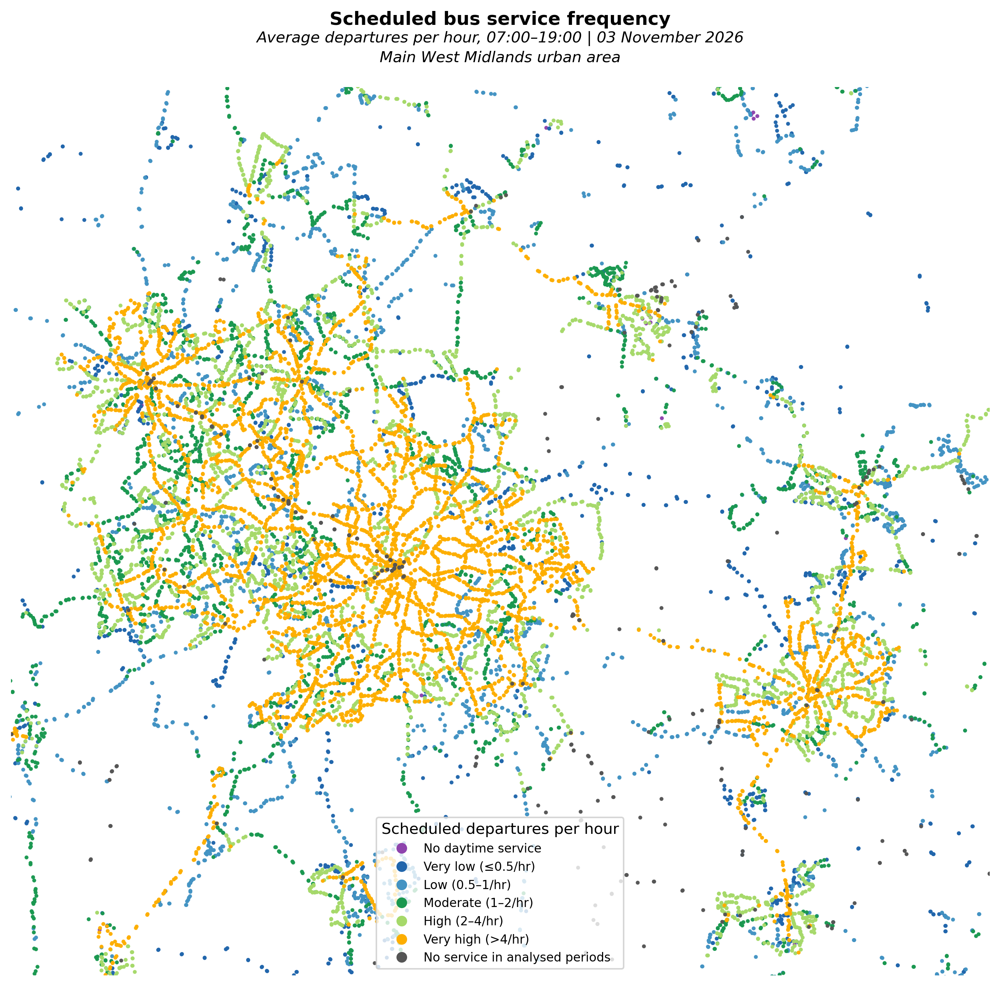
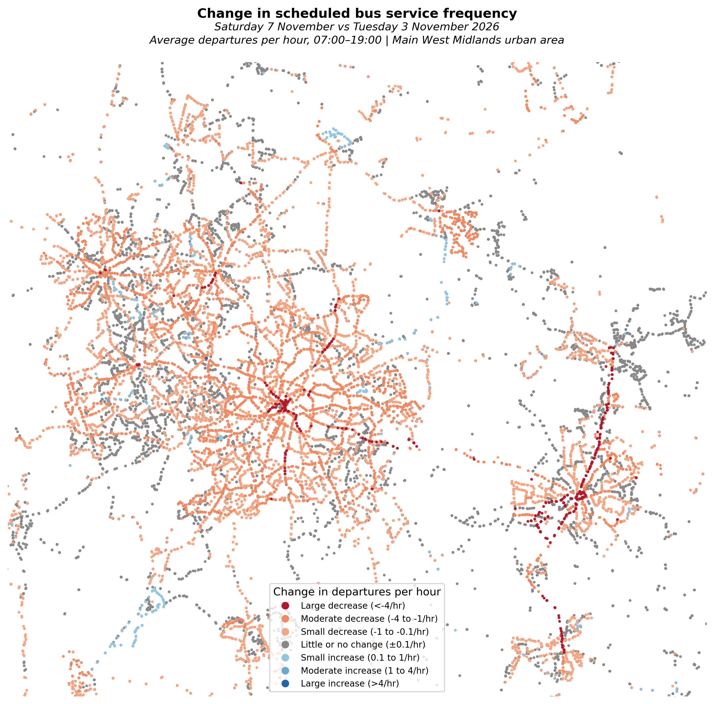

# Mapping Scheduled Public Transport Provision in the West Midlands

### Python | GTFS | GeoPandas | Folium | Transport Data Analysis

## Project overview

This project analyses archived General Transit Feed Specification (GTFS) timetable data to investigate spatial and temporal variation in scheduled public transport provision across the West Midlands regional network.

The analysis focuses on three questions:

- How does scheduled bus service frequency vary across the network and throughout the day?
- How does route diversity relate to service frequency, and where are potential transport hubs concentrated?
- How does scheduled bus provision change between a weekday and Saturday?

The project combines timetable processing, exploratory data analysis and geospatial visualisation to identify patterns in scheduled network provision.

## Data and methodology

### Data source and licence

**Source:** Department for Transport (DfT), Bus Open Data Service (BODS).

**Dataset:** [West Midlands regional GTFS timetable data](https://data.bus-data.dft.gov.uk/timetable/download/gtfs-file/west_midlands/), downloaded 2 November 2026.

**Licence:** [Open Government Licence v3.0](https://www.nationalarchives.gov.uk/doc/open-government-licence/version/3/).

Contains public sector information licensed under the Open Government Licence v3.0.

The analysis, interpretations and visualisations are independently produced and are not endorsed by the Department for Transport or individual transport operators.

The original GTFS dataset is not included in this repository. The download link provides the current version, which may differ from the archived version used in this analysis.

### Methodolgy

The analysis uses an archived GTFS dataset dated **2 November 2026**, containing approximately 30,500 stops, 1,166 routes and 6.6 million stop-time records.

The main analysis examines **Tuesday 3 November 2026**, with a comparison against **Saturday 7 November 2026**.

Using Python, pandas, GeoPandas and Folium, the workflow:

1. Identifies active services using GTFS calendar records and exceptions.
2. Calculates scheduled departures per stop across morning peak, interpeak, afternoon peak and evening periods.
3. Measures route diversity using distinct GTFS route identifiers.
4. Identifies potential bus hubs using route diversity and scheduled frequency.
5. Examines hourly departure patterns at selected stops.
6. Compares Tuesday and Saturday service provision and maps the geographic differences.

The main daytime frequency measure covers **07:00–19:00**. Evening services are examined separately.

## Key findings

- **85% of stops** receiving scheduled daytime bus services are served by three or fewer distinct routes.
- Of **519 potential bus hubs** serving eight or more routes, only **92** have at least 20 scheduled daytime departures per hour.
- Some stops with high route diversity have departures concentrated around school travel times, demonstrating that route diversity does not necessarily indicate frequent all-day service.
- Saturday has **17.0% fewer scheduled trips** than Tuesday across the full GTFS feed.
- Scheduled daytime bus departures decrease by **16.0%**, while the number of stops receiving daytime bus service falls by **7.2%**.
- Changes in scheduled frequency are spatially uneven, with reductions concentrated along some corridors.

## Visualisations

### Scheduled daytime bus service frequency

This map shows variation in average scheduled bus departures per hour across the main West Midlands urban area.

### Weekday–weekend service frequency changes

This map shows the change in scheduled daytime bus departures per hour between Tuesday 3 November and Saturday 7 November 2026.

### Additional interactive and temporal analysis

- [Explore the interactive bus hubs map](https://johanna-cox.github.io/west-midlands-gtfs-analysis/wm_bus_hubs.html)
- [View the hourly departure heatmap](https://johanna-cox.github.io/west-midlands-gtfs-analysis/wm_school_time_heatmap.html)

## Explore the analysis

The full analysis, including methodology, code, tables and interpretation, is available in the [Jupyter notebook](west_midlands_gtfs_analysis.ipynb).

The notebook includes a configurable analysis date and produces CSV tables and map outputs.

## Limitations

The analysis examines scheduled rather than observed services and does not measure punctuality, cancellations or passenger demand.

The GTFS dataset extends beyond the metropolitan West Midlands, while the static frequency maps focus on the main urban area. Route diversity and hub classifications are exploratory measures and do not directly establish passenger accessibility or interchange activity.

Findings relate to the selected November 2026 dates and should not be assumed to represent all operating days or seasons.

## Reproducibility

The analysis was developed in Python using Jupyter Notebook, pandas, NumPy, GeoPandas, Shapely, Matplotlib and Folium.

Install the required Python packages using:

pip install -r requirements.txt

The original GTFS dataset is not included in the repository due to its size. Data can be obtained from the Department for Transport's Bus Open Data Service. The analysis uses an archived dataset downloaded on 2 November 2026; results may differ when using a newer version.

To reproduce the analysis, download the GTFS data, configure the local file path in the notebook and run the cells in sequence.

The ANALYSIS_DATE parameter controls the main analysis date. The Tuesday–Saturday comparison uses fixed dates (3 and 7 November 2026).

## AI-assisted development

ChatGPT was used to support Python code development, debugging, visualisation and documentation.

The analysis was developed iteratively, with code executed, tested and refined in Jupyter Notebook. Analytical choices, interpretation of results and validation of outputs were reviewed throughout the project.

## Future development

Possible extensions include integrating population and accessibility data, assessing walking access to frequent services and examining geographic differences in transport provision relative to local demand.
